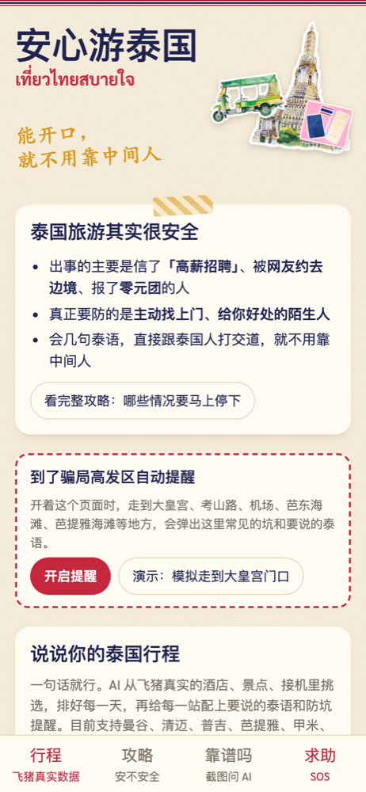
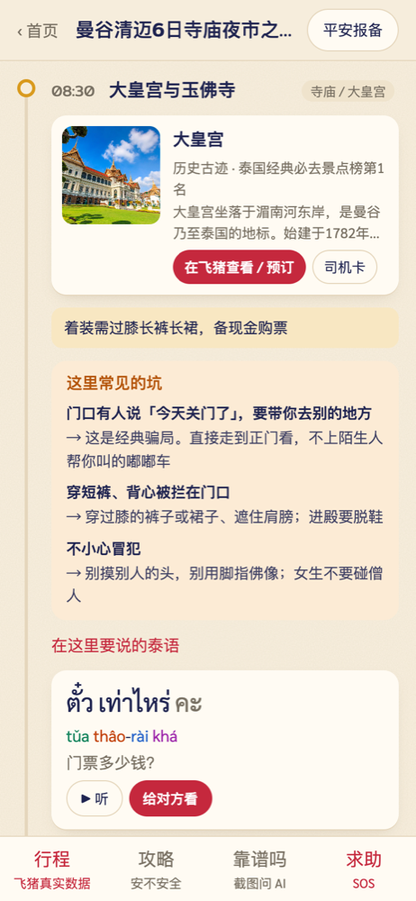
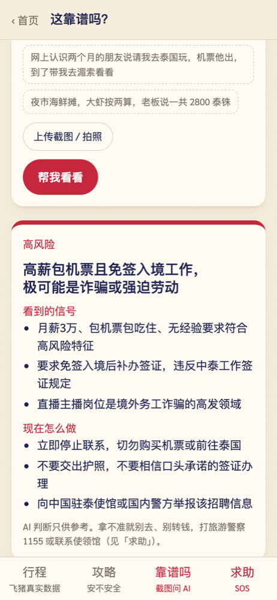
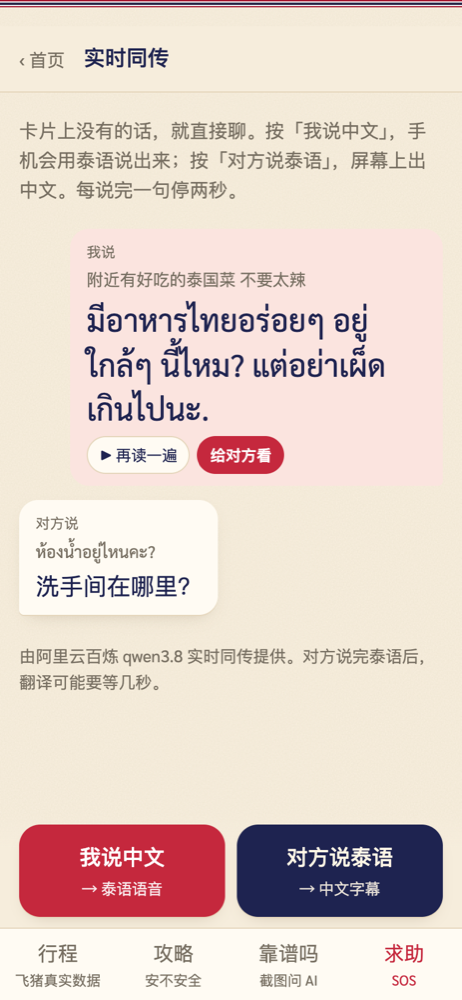
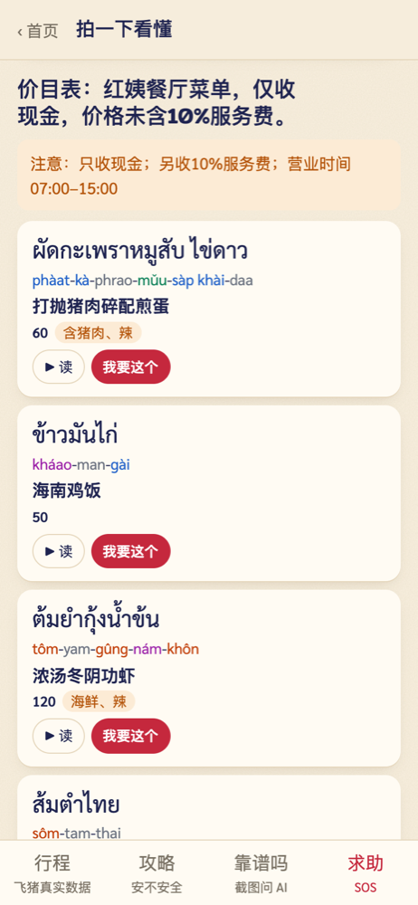
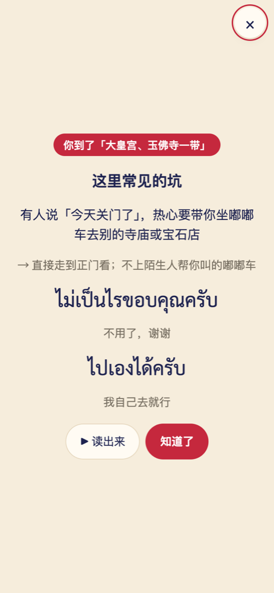
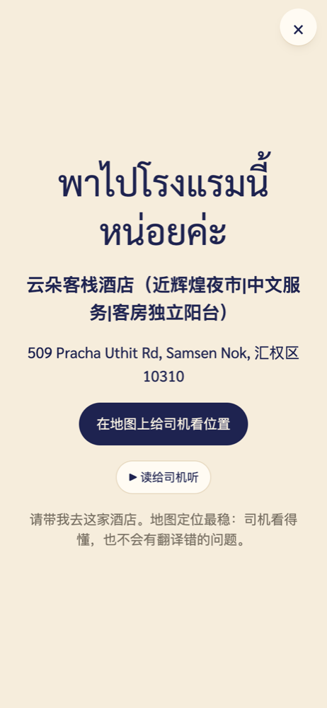
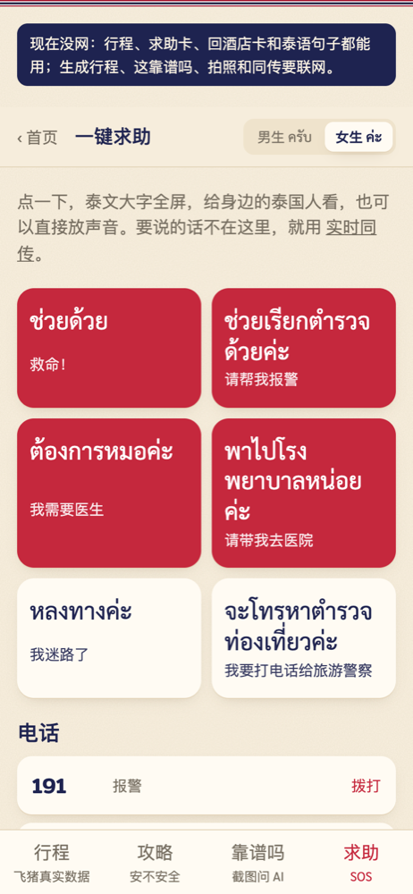
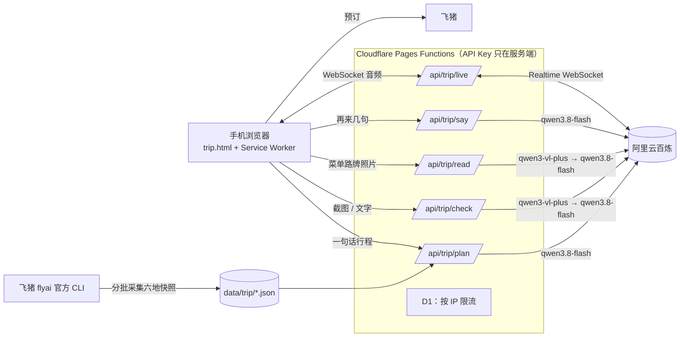

# 开口泰·安心游泰国

**能开口，就不用靠中间人。**

2026 飞猪 AI 旅行创新大赛参赛作品。飞猪帮你订到靠谱的行程，开口泰帮你一路直接跟泰国人打交道，家里人也放心。

**在线体验：https://bianzithai.pages.dev/trip** （手机打开效果最好，免登录）

| 首页 | 行程 + 防坑提醒 | 这靠谱吗 | 实时同传 |
|---|---|---|---|
|  |  |  |  |
| **拍一下看懂** | **骗局高发区提醒** | **回酒店卡** | **断网也能用** |
|  |  |  |  |

## 为什么做这个

很多人觉得泰国不安全。但中国驻泰使馆 2026 年的几次提醒里，出事的主要是三类：信了「高薪招聘、包机票包吃住」被骗到泰缅边境；被网上认识的「朋友」约来泰国后被控制；报了零元团被强制购物。正常来旅游其实很安全。

风险集中在**被中间人带着走**的时候：语言不通，就只能靠主动找上门、会说中文的陌生人来介绍工作、带路、报团、换钱。作者在曼谷生活、做直播带货业务，天天和泰国同事打交道——会几句泰语，直接跟泰国人打交道，就不用靠中间人。

## 功能

| 功能 | 做什么 | 用到的百炼能力 |
|---|---|---|
| 一句话生成行程 | 从飞猪真实的酒店、景点、接送机、一日游里挑选、按天排好，每项都能跳到飞猪预订；代码校验每个 id 都是真实商品 | qwen3.8-flash |
| 每站防坑提醒 + 要说的泰语 | 按地点类型给出常见的坑、怎么应对和当场用得上的泰语（39 句课程句子，男女声真人发音）；不够可让 AI 现写 | qwen3.8-flash |
| 骗局高发区自动提醒 | 开着页面时走到大皇宫一带、考山路、机场、芭东海滩等 8 个地方，主动弹出提醒 | — |
| 我在哪一站 / 回酒店卡 | 定位到行程里最近的一站；回酒店卡用飞猪原始地址 + 地图定位给司机看 | — |
| 这靠谱吗 | 截图或粘贴陌生人的招聘、交友邀约、低价团、报价，给出风险等级、理由和建议 | qwen3-vl-plus + qwen3.8-flash |
| 拍一下看懂 | 菜单、路牌、告示：逐行意思、读音、忌口、价格陷阱；菜单可一键生成点餐卡 | qwen3-vl-plus + qwen3.8-flash |
| 实时中泰同传 | 你说中文手机说泰语；对方说泰语屏幕出中文 | qwen3.8-livetranslate-flash-realtime |
| 一键求助 / 平安报备 | 泰文求助卡、报警急救电话、按定位找负责的中国使领馆；一键把位置和当天安排发给家人 | — |
| 出发前攻略 | 安不安全、哪些信号要停下、2026 入境新规；每条附使馆或官方来源 | — |
| 断网可用 | 行程、求助卡、回酒店卡、全部泰语和发音缓存在手机里 | — |

目前支持曼谷、清迈、普吉、芭提雅、甲米、苏梅岛。

## 商业闭环

- 作者已开通**飞猪推广者**：酒店、接送机、一日游等预订链接由推广者正式接口生成，用户在飞猪下单后自动归因分佣（以酒店、度假类为主）。
- 对用户免费；收入来自飞猪佣金和开口泰 AI 陪练的按量付费。
- 对飞猪：先把「泰国安不安全」的顾虑讲清楚，再把用户从街边揽客、零元团引回飞猪上的正规商家。

## 架构



## 百炼怎么用

- **运行时链路**：所有 AI 能力都在运行时由 Cloudflare Pages Functions 调用百炼（OpenAI 兼容接口 `/compatible-mode/v1/chat/completions`，同传为 Realtime WebSocket），关闭思考模式，JSON 输出带一次重试。
- **行程**：一句话 →（qwen3.8-flash）城市、晚数、日期、人数、兴趣 →（qwen3.8-flash + 飞猪候选列表）按天排好的行程 → 代码校验 id、按真实商品所属城市修正每天的城市、从入住站反推酒店。
- **这靠谱吗 / 拍一下看懂**：视觉模型只负责照抄图片里的文字（自由描述会编造菜名），解释交给文本模型，且只能依据照抄的内容。
- **读音**：AI 写的泰语读音用开口泰课程里校对过的词库覆盖，避免声调标错。
- **同传**：浏览器 WebSocket 不能带鉴权头，由 Functions 建立上游连接并转发；播放译音时麦克风发送静音帧，避免把自己的声音再翻一遍。

## 飞猪数据

作者已开通飞猪推广者。酒店、景点和可订商品由 flyai（`@fly-ai/flyai-cli`）**推广者正式接口**于 2026-10-16 采集，覆盖曼谷、清迈、普吉、芭提雅、甲米、苏梅岛（150 家酒店全部带真实参考价、166 个景点、298 个可订商品，其中 72 个带佣金）。预订链接由推广者身份生成，价格和库存以飞猪页面为准。采集分批间隔进行，网站只读快照、不在用户请求时实时调用。快照数据未放入本仓库。

## 目录

```
trip.html                 页面（单文件，原生 JS）
sw-trip.js                离线缓存（只作用于 /trip，不影响开口泰主站）
functions/_lib/bailian.js 百炼调用、JSON 重试、读音词库校对、限流
functions/api/trip/       plan / check / read / say / live 五个接口
data/trip/anxin.json      安全内容：39 句泰语、各类地点的坑、8 个高发区、求助电话、来源
screenshots/              截图
```

页面依赖开口泰主站的字体、贴纸、发音文件和飞猪快照，单独克隆本仓库无法完整运行，请直接体验在线版本。部署需要 Cloudflare Pages 的 `DASHSCOPE_API_KEY`、`DASHSCOPE_BASE` 两个密钥和一张 D1 表：

```sql
CREATE TABLE IF NOT EXISTS trip_calls (ts INTEGER NOT NULL, ip TEXT NOT NULL, k TEXT NOT NULL);
```

## 说明

- 安全信息截至 2026 年 10 月，来源见页面「出发前攻略」底部；使领馆电话已对照各使领馆官网核对。政策会变，出行前请以官方公告为准。
- AI 判断只供参考。拿不准就别去、别转钱，打泰国旅游警察 1155 或联系中国驻泰使领馆。
- 代码仅供大赛评审参考，未授权其他用途。

作者：辫子（[@bianzigege](https://github.com/bianzigege)）· 开口泰 https://bianzithai.pages.dev
